# 📄 Awesome PDF Utilities 🚀

<p align="center">
  
</p>

<p align="center">
  <a href="https://github.com/ishandutta2007/Awesome-Awesome-Awesome"></a>
  <a href="https://discord.gg/jc4xtF58Ve"></a>
  <a href="https://github.com/ishandutta2007/Awesome-PDF-Utilities/stargazers"></a>
  <a href="https://github.com/ishandutta2007/Awesome-PDF-Utilities/network/members"></a>
  <a href="https://github.com/ishandutta2007/Awesome-PDF-Utilities/blob/main/LICENSE"></a>
  <a href="https://github.com/ishandutta2007/Awesome-PDF-Utilities/pulls"></a>
  <a href="https://github.com/ishandutta2007"></a>
</p>

---

## 🌟 Top PDF Utilities & Document Manipulation Ecosystem

> **The definitive curated index of high-performance SaaS platforms, self-hosted Docker microservices, WebAssembly browser-side toolkits, and programmatic developer libraries for PDF manipulation.**

PDFs remain the immutable backbone of global business — contracts, legal discovery, medical records, financial audits, invoices, and academic archives all live in Portable Document Format. Yet processing them often forces organizations into a painful compromise: paying extortionate monthly seat licenses or uploading strictly confidential files to third-party cloud servers.

This index curates the best **privacy-first, self-hosted, and client-side PDF utilities**, alongside leading **enterprise SaaS engines**. Whether you need to automate headless PDF merging, execute OCR on thousands of scans, sanitize metadata, redact confidential PII, or assemble interactive forms in WebAssembly, this repository is your technical roadmap.

---

## 📑 Table of Contents

- [📊 Sector Overview & Market Dynamics](#-sector-overview--market-dynamics)
- [🏢 SaaS & Hosted Commercial Platforms](#-saas--hosted-commercial-platforms)
- [🛠️ Open-Source GitHub Projects](#️-open-source-github-projects)
  - [🌐 Self-Hosted & Web Applications](#-self-hosted--web-applications)
  - [👁️ OCR Engines & Scanned Document Processors](#️-ocr-engines--scanned-document-processors)
  - [🖥️ Command-Line Utilities & Structural Engines](#️-command-line-utilities--structural-engines)
  - [🧩 Developer Libraries & Programmatic Frameworks](#-developer-libraries--programmatic-frameworks)
- [🧭 Decision Matrix: Choosing the Right Tool](#-decision-matrix-choosing-the-right-tool)
- [🤝 How to Contribute](#-how-to-contribute)
- [💖 Support & Community](#-support--community)
- [📈 Star History](#-star-history)
- [⚖️ Disclaimer & License](#️-disclaimer--license)

---

## 📊 Sector Overview & Market Dynamics

The global PDF software and document productivity market was valued at **$3.24 Billion in 2024** and is projected to expand to **$6.85 Billion by 2031**, progressing at a compound annual growth rate (**CAGR**) of **11.3%**. 

From a market structure perspective, the industry exhibits **high concentration at the enterprise apex**, where Adobe commands an estimated >55% market share in paid enterprise seats. However, the broader mid-market, SMB, and developer tiers are **moderately-to-highly fragmented**. Rising discontent over recurring subscription lock-in, vendor telemetry, and strict compliance regimes (GDPR, HIPAA, SOC 2) has triggered explosive demand for **privacy-first WebAssembly engines** (client-side zero-knowledge execution) and **self-hosted Docker microservices** (like Stirling-PDF and BentoPDF) that prevent sensitive enterprise data from leaving internal perimeters.

---

## 🏢 SaaS & Hosted Commercial Platforms

The table below compiles leading hosted and desktop-cloud commercial PDF platforms, sorted by **Company Scale (Revenue & Valuation)** in descending order. Every pricing tier and free tier limit reflects verified starting plans.

| 🏢 Platform | 🌐 Official Link | 📈 Company Scale (Revenue / Valuation) | 💳 Starting Tier Pricing | 🎁 Free Tier Limits & Trial Terms | 🎯 Key Differentiator & Capabilities | ⚠️ Trade-offs & Privacy Note |
| :--- | :--- | :--- | :--- | :--- | :--- | :--- |
| **Adobe Acrobat Pro** | [acrobat.adobe.com](https://acrobat.adobe.com/) | **~$21.5B Annual Revenue** (Adobe Inc., Market Cap ~$180B) | **$12.99 / user / month** (Acrobat Standard, annual commitment) or **$19.99 / user / month** (Pro) | **7-Day Free Trial** (requires payment method, gives full Acrobat Pro feature set) + Free Acrobat Reader (view, comment, print only) | Industry gold standard; full PDF editing, redaction, accessible PDF/UA tags, preflighting, and legally binding e-signatures. | Heavy resource footprint, proprietary cloud syncing, vendor lock-in, and aggressive recurring licensing models. |
| **Foxit PDF Editor** | [foxit.com](https://www.foxit.com/) | **~$95M Annual Revenue** (Foxit Software, Market Cap ~$1.4B) | **$11.00 / user / month** (Editor Suite, $132.00 billed annually) | **14-Day Free Trial** (full access to desktop & cloud editor features, watermark-free during trial) + Free Foxit Reader | High-performance enterprise alternative to Adobe with lower resource overhead, robust volume licensing, and group policy management. | Cloud document exchange features send telemetry and metadata to remote hosted infrastructure. |
| **pdfFiller** | [pdffiller.com](https://www.pdffiller.com/) | **~$1.25B Valuation** (airSlate Inc. Series D Unicorn, ~$110M+ ARR) | **$8.00 / user / month** (Basic Plan, $96.00 billed annually) | **30-Day Free Trial** (registration required, full access to edit, e-sign, fill forms, and export) | Cloud-native document builder and interactive form generator with extensive drag-and-drop workflow automation integrations. | Files reside in cloud storage; not compliant with air-gapped or zero-cloud organizational policies. |
| **Nitro Pro** | [gonitro.com](https://www.gonitro.com/) | **~$250M Valuation** (Acquired by Potentia Capital, ~$65M Annual Revenue) | **$14.99 / user / month** (Nitro PDF Pro Windows annual) or **$179.99** one-time perpetual license | **14-Day Free Trial** (no credit card required, unlimited PDF conversions, edits, and exports) | Native Windows desktop performance, Microsoft Office integration, and perpetual purchase licensing options. | Mac and Linux feature parity lags Windows release; cloud-connected features require enterprise contract. |
| **Smallpdf** | [smallpdf.com](https://smallpdf.com/) | **~$150M Valuation** (Smallpdf AG, ~$28M ARR profitable SaaS) | **$9.00 / month** (Pro Individual, $108.00 billed annually) | **Free Forever Tier**: 2 document tasks per day across 21 web tools, or **7-Day Unlimited Trial** | Intuitive drag-and-drop browser UX for occasional document surgery, splitting, compression, and rapid signature collection. | Server-side file processing uploads documents to Smallpdf servers; strictly unsuitable for confidential materials. |
| **ILovePDF** | [ilovepdf.com](https://www.ilovepdf.com/) | **~$50M Valuation** (ILovePDF / Mendeley, ~$12M Annual Revenue) | **$4.00 / month** (Premium Web + Desktop, $48.00 billed annually) | **Free Forever Tier**: Web access with 25 MB max file size limit and max 3 simultaneous files per batch task | Very affordable high-throughput consumer web utility with mobile companion applications and desktop batch converters. | Free tier relies on remote file uploads and server queues; file caching occurs during pipeline execution. |
| **Sejda PDF** | [sejda.com](https://www.sejda.com/) | **~$30M Valuation** (Sejda BV, ~$8M Annual Revenue) | **$5.00** (7-day Web Week Pass) or **$7.50 / month** ($63.00/year for Desktop + Web) | **Free Forever Tier**: 3 tasks per hour, documents up to 200 pages or 50 MB file size limit | In-browser inline text editing of existing PDF paragraphs without converting to DOCX first; generous recurrent free tier. | Hosted web version runs processing server-side; desktop offline edition requires paid subscription. |

---

## 🛠️ Open-Source GitHub Projects

Below are the most prominent open-source projects, tools, and developer libraries for PDF processing, sorted in **descending order by GitHub Stars_Count**. Each repository badge links directly to its stargazer community.

---

### 1. [Stirling-PDF](https://github.com/Stirling-Tools/Stirling-PDF) [](https://github.com/Stirling-Tools/Stirling-PDF/stargazers)
- **Primary Category**: 🌐 Self-Hosted All-in-One Web Suite
- **Stars**: ~94.7k ⭐ | **License**: GPL-3.0 / Open-Core
- **Description**: The undisputed leader in self-hosted PDF management. Packs over **50+ PDF utilities into a single Docker container**: merge, split, rotate, reorganize, compress (via QPDF), OCR (via Tesseract), convert (Office, HTML, Markdown via LibreOffice), password-protect, watermark, certify, sanitize, and redact.
- **Standout Capability**: Automated **Pipelines** chain consecutive actions together, and a comprehensive **REST API** allows programmatic automation without third-party SaaS fees. Files are processed in local memory and purged automatically upon completion.
- **Deployment**:
  ```bash
  docker run -d -p 8080:8080 -v /location/of/trainingData:/usr/share/tessdata stirlingtools/stirling-pdf:latest
  ```

---

### 2. [Tesseract OCR](https://github.com/tesseract-ocr/tesseract) [](https://github.com/tesseract-ocr/tesseract/stargazers)
- **Primary Category**: 👁️ Neural Network OCR Engine
- **Stars**: ~77.1k ⭐ | **License**: Apache-2.0
- **Description**: The foundational open-source optical character recognition engine sponsored by Google and maintained by the open-source community. Employs LSTM recurrent neural networks to recognize text across 100+ languages and 35+ writing systems.
- **Standout Capability**: Serves as the underlying OCR text detection engine inside OCRmyPDF, Stirling-PDF, and hundreds of document extraction pipelines.

---

### 3. [PDF.js](https://github.com/mozilla/pdf.js) [](https://github.com/mozilla/pdf.js/stargazers)
- **Primary Category**: 🌐 Web Standards PDF Renderer & Parser
- **Stars**: ~54.0k ⭐ | **License**: Apache-2.0
- **Description**: Mozilla’s community-driven HTML5 and WebGL PDF reader. Parses and renders PDF files directly within modern web browsers without native plugin dependencies.
- **Standout Capability**: Powers native PDF viewing in Firefox, Chrome extensions, and browser-based PDF preview canvases worldwide.

---

### 4. [OCRmyPDF](https://github.com/ocrmypdf/OCRmyPDF) [](https://github.com/ocrmypdf/OCRmyPDF/stargazers)
- **Primary Category**: 👁️ Scanned Document Archival & Search Layer
- **Stars**: ~35.1k ⭐ | **License**: MPL-2.0
- **Description**: The industry standard for retrofitting scanned PDF documents with a searchable text layer. Generates archival-grade **PDF/A** files while meticulously preserving the visual integrity of historical records.
- **Standout Capability**: Features automatic skew detection, orientation correction, lossless image optimization, and multi-core batch processing. Essential for RAG document ingestion pipelines.
- **CLI Example**:
  ```bash
  ocrmypdf --deskew --clean --optimize 3 input_scan.pdf output_searchable.pdf
  ```

---

### 5. [React-PDF](https://github.com/diegomura/react-pdf) [](https://github.com/diegomura/react-pdf/stargazers)
- **Primary Category**: 🧩 Declarative React PDF Generation
- **Stars**: ~16.8k ⭐ | **License**: MIT
- **Description**: Build PDF files using standard React component architecture (`<Document>`, `<Page>`, `<Text>`, `<View>`, `<Image>`). Renders seamlessly in Node.js server environments or directly inside browser clients.
- **Standout Capability**: Declarative flexbox styling makes invoice and receipt generation as intuitive as building modern web interfaces.

---

### 6. [BentoPDF](https://github.com/alam00000/bentopdf) [](https://github.com/alam00000/bentopdf/stargazers)
- **Primary Category**: 🌐 Privacy-First Browser-Side WebAssembly Toolkit
- **Stars**: ~16.1k ⭐ | **License**: AGPL-3.0
- **Description**: A comprehensive PDF utility suite providing **130+ tools executed entirely within the client's browser using WebAssembly**. Because processing is 100% local, no document data ever travels over the network.
- **Standout Capability**: Can be deployed as a static bundle on GitHub Pages, Cloudflare Pages, or air-gapped intranets with zero backend infrastructure or database dependencies.

---

### 7. [pdfmake](https://github.com/bpampuch/pdfmake) [](https://github.com/bpampuch/pdfmake/stargazers)
- **Primary Category**: 🧩 Client/Server Declarative PDF Printing
- **Stars**: ~12.4k ⭐ | **License**: MIT
- **Description**: Pure JavaScript client-side and server-side document generation engine driven by JSON document definitions rather than imperative coordinate drawing.
- **Standout Capability**: Native support for complex nested tables, multi-column layouts, page headers/footers, and client-side browser print dialogues.

---

### 8. [PyMuPDF (fitz)](https://github.com/pymupdf/PyMuPDF) [](https://github.com/pymupdf/PyMuPDF/stargazers)
- **Primary Category**: 🧩 High-Performance Python Manipulation Engine
- **Stars**: ~11.0k ⭐ | **License**: AGPL-3.0 / Commercial
- **Description**: Ultra-fast Python bindings for the MuPDF rendering and parsing engine. Recognized for lightning-fast text extraction, table recognition, vector rasterization, and coordinate detection.
- **Standout Capability**: Consistently benchmarks 10x–30x faster than pure-Python counterparts; the preferred foundation for AI/LLM document chunking and preprocessing.

---

### 9. [PDFKit](https://github.com/foliojs/pdfkit) [](https://github.com/foliojs/pdfkit/stargazers)
- **Primary Category**: 🧩 Low-Level Node.js & Browser PDF Generator
- **Stars**: ~10.7k ⭐ | **License**: MIT
- **Description**: An established, full-featured PDF generation library for Node.js and browsers. Provides granular programmatic control over vector graphics, font embedding, gradients, and document metadata.
- **Standout Capability**: Powers many higher-level document generation wrappers (including earlier iterations of pdfmake).

---

### 10. [pypdf](https://github.com/py-pdf/pypdf) [](https://github.com/py-pdf/pypdf/stargazers)
- **Primary Category**: 🧩 Pure-Python PDF Manipulation
- **Stars**: ~10.3k ⭐ | **License**: BSD-3-Clause
- **Description**: The classic, dependency-free pure-Python PDF library (merging PyPDF2 back into the unified pypdf project). Capable of splitting, merging, cropping, encrypting, decrypting, and reading form fields.
- **Standout Capability**: Zero C-dependencies makes deployment instant in serverless environments, AWS Lambda, and constrained CI/CD runners.

---

### 11. [pdfcpu](https://github.com/pdfcpu/pdfcpu) [](https://github.com/pdfcpu/pdfcpu/stargazers)
- **Primary Category**: 🖥️ Go PDF Processor & CLI Engine
- **Stars**: ~8.9k ⭐ | **License**: Apache-2.0
- **Description**: A dedicated PDF processing engine written from scratch in Go. Emphasizes PDF compliance, memory safety, and high-throughput batch operation across enterprise clusters.
- **Standout Capability**: Provides blazing-fast CLI commands for validating PDF specifications, optimizing file sizes, attaching files, trimming margins, and stamping watermarks.

---

### 12. [pdf-lib](https://github.com/Hopding/pdf-lib) [](https://github.com/Hopding/pdf-lib/stargazers)
- **Primary Category**: 🧩 TypeScript/JavaScript Modification Engine
- **Stars**: ~8.7k ⭐ | **License**: MIT
- **Description**: Create and modify PDF documents in any JavaScript environment without native C++ compilation. Supports drawing text, shapes, embedding PNG/JPEG images, and flattening interactive AcroForms.
- **Standout Capability**: Powers the core document manipulation logic in client-side suites like BentoPDF.

---

### 13. [pdfminer.six](https://github.com/pdfminer/pdfminer.six) [](https://github.com/pdfminer/pdfminer.six/stargazers)
- **Primary Category**: 🧩 Typographic Text & Layout Extraction
- **Stars**: ~7.0k ⭐ | **License**: MIT
- **Description**: The community-maintained Python library dedicated to extracting exact text, font families, bounding boxes, and structural layout information from complex PDF streams.
- **Standout Capability**: Unrivaled typographic accuracy for reconstructing exact reading orders from multi-column journals and legal briefs.

---

### 14. [PDF Arranger](https://github.com/pdfarranger/pdfarranger) [](https://github.com/pdfarranger/pdfarranger/stargazers)
- **Primary Category**: 🖥️ Graphical Interactive Page Reorganizer
- **Stars**: ~6.0k ⭐ | **License**: GPL-3.0
- **Description**: A lightweight Python-GTK graphical interface for quick page-level surgery: merging, reordering, rotating, cropping, and deleting individual pages.
- **Standout Capability**: Acts as a user-friendly frontend for `pikepdf`, offering portable Windows binaries via PortableApps.com and native Linux desktop packages.

---

### 15. [QPDF](https://github.com/qpdf/qpdf) [](https://github.com/qpdf/qpdf/stargazers)
- **Primary Category**: 🖥️ C++ Structural Transformation Engine & CLI
- **Stars**: ~5.5k ⭐ | **License**: Apache-2.0
- **Description**: The industry’s gold standard low-level engine for content-preserving PDF transformations. Handles structural linearization (Fast Web View), encryption, decryption, object streams, and integrity repair.
- **Standout Capability**: Powers the core compression and structural repair pipeline inside Stirling-PDF, pikepdf, and commercial prepress engines.

---

### 16. [pikepdf](https://github.com/pikepdf/pikepdf) [](https://github.com/pikepdf/pikepdf/stargazers)
- **Primary Category**: 🧩 Pythonic QPDF Bindings
- **Stars**: ~2.8k ⭐ | **License**: MPL-2.0
- **Description**: Bridges the battle-tested C++ performance of QPDF with idiomatic Python list and dict syntax.
- **Standout Capability**: Fast, memory-safe replacement for older Python manipulation tools; allows instant page splitting, object stream inspection, and PDF metadata pruning.

---

### 17. [CoherentPDF (cpdf)](https://github.com/coherentgraphics/cpdf-binaries) [](https://github.com/coherentgraphics/cpdf-binaries/stargazers)
- **Primary Category**: 🖥️ Advanced Imposition & Production Prepress CLI
- **Stars**: ~740 ⭐ | **License**: AGPL-3.0 / Commercial
- **Description**: Commercial-grade command-line toolkit specialized in advanced imposition (n-up, booklet preparation), bookmark tree preservation, Bates numbering, and JSON document inspection.
- **Standout Capability**: Handles complex imposition calculations and PDF linearization without altering underlying color spaces.

---

### 18. [veraPDF](https://github.com/veraPDF/veraPDF-library) [](https://github.com/veraPDF/veraPDF-library/stargazers)
- **Primary Category**: 🖥️ PDF/A & PDF/UA Conformance Validator
- **Stars**: ~350 ⭐ | **License**: GPL-3.0 / MPL-2.0
- **Description**: The official open-source, industry-supported conformance validator for ISO 19005 (PDF/A for long-term archiving) and ISO 14289 (PDF/UA for universal accessibility).
- **Standout Capability**: Used by national archives, government institutions, and legal bodies worldwide to certify regulatory compliance before document preservation.

---

## 🧭 Decision Matrix: Choosing the Right Tool

| Architectural Need | Recommended Tool | Why This Choice? | Key Consideration |
| :--- | :--- | :--- | :--- |
| **All-in-One Self-Hosted Web GUI** | **[Stirling-PDF](https://github.com/Stirling-Tools/Stirling-PDF)** | 50+ tools in Docker, REST API, workflow pipelines | Requires ~2–4 GB RAM for LibreOffice conversion jobs |
| **Zero-Server Browser-Only Privacy** | **[BentoPDF](https://github.com/alam00000/bentopdf)** | 130+ tools in WebAssembly; files never touch a remote server | Client CPU handles heavy conversions; no direct text re-flow |
| **Batch Scanned Archive Searchability** | **[OCRmyPDF](https://github.com/ocrmypdf/OCRmyPDF)** | Best-in-class Tesseract integration, PDF/A compliance | Multi-threaded CPU intensive; best run in background workers |
| **Rapid Desktop Page Surgery** | **[PDF Arranger](https://github.com/pdfarranger/pdfarranger)** | Instant visual page drag/drop, split, rotate, and crop | Desktop GTK GUI only; not designed for automated pipelines |
| **High-Throughput Serverless Pipeline** | **[pypdf](https://github.com/py-pdf/pypdf)** or **[pdfcpu](https://github.com/pdfcpu/pdfcpu)** | Pure-Python or Go binaries with zero dynamic C runtimes | Best for merging, encryption, and light extraction |
| **High-Performance AI/RAG Ingestion** | **[PyMuPDF](https://github.com/pymupdf/PyMuPDF)** | 10x-30x faster text & image extraction than competitors | AGPL-3.0 copyleft or commercial license required |
| **Low-Level Structural Repair & Optimization** | **[QPDF](https://github.com/qpdf/qpdf)** | Flawless linearization, structural repair, and stream cleanup | Command-line and C++ interface; requires scripting |

---

## 🤝 How to Contribute

Contributions are warmly welcomed! Help keep this ecosystem guide fresh, accurate, and valuable for the open-source community:

1. **Fork this repository** to your GitHub account.
2. **Review inclusion criteria**:
   - SaaS platforms must specify exact starting pricing and non-generic free tier terms.
   - Open-source projects must have active maintenance, transparent licensing, and clear documentation.
3. **Format entries** matching existing markdown structures.
4. **Submit a Pull Request** with a concise description of the tool and why it deserves inclusion.

Check out our curated list collection at [Awesome-Awesome-Awesome](https://github.com/ishandutta2007/Awesome-Awesome-Awesome).

---

## 💖 Support & Community

Thank you for exploring and building with **Awesome PDF Utilities**! If this resource saved you time, reduced your cloud bills, or helped you protect user privacy, please consider supporting the project:

- ⭐ **Star this repository** to help fellow developers and privacy advocates find it.
- 🍴 **Fork and share** with your engineering team, DevOps groups, or open-source peers.
- 📢 **Join our community**: Hop into our [Discord Server](https://discord.gg/jc4xtF58Ve) to discuss self-hosted infrastructure and document tooling.
- ☕ **Sponsor the Maintainer**: Support ongoing updates, benchmarks, and curation via the [GitHub Sponsor Dashboard](https://github.com/sponsors/ishandutta2007).

---

## 📈 Star History

[](https://star-history.dera.page/#ishandutta2007/Awesome-PDF-Utilities&type=date&legend=top-left)

---

## ⚖️ Disclaimer & License

- **Disclaimer**: This repository is a community-curated educational and technical resource. Product names, logos, and brands are property of their respective owners. Mention does not constitute commercial affiliation or endorsement.
- **License**: Released under the [MIT License](LICENSE).
